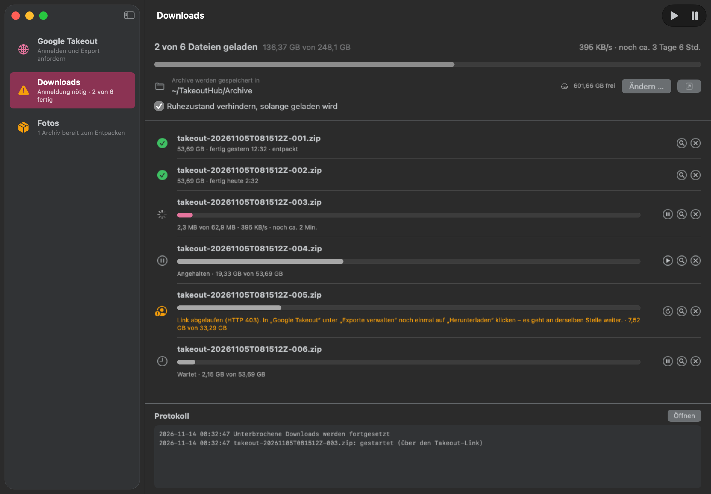

# TakeoutHub

A small Mac app (SwiftUI) that brings Google Photos to your Mac via Google Takeout, even over a slow connection. The download runs in the app, not in the browser. If the connection drops, it continues where it left off, even after restarting the Mac. Runs entirely locally and talks only to Google.



<sub>The screenshot shows sample data only. The app's interface is in German and always dark (a Darcula look, like the other hub apps); labels are quoted below with their English meaning.</sub>

## Installation

**Requirements:** macOS 14 or later and the Command Line Tools (`xcode-select --install`).

```bash
git clone git@github.com:marionitschke/takeouthub.git
cd takeouthub
./build.sh --install
```

The app is then in `/Applications/StudioHub/TakeoutHub.app`. Because it is built on your Mac and signed ad hoc, it starts without a Gatekeeper prompt.

- **Update:** `git pull && ./build.sh --install`
- **Uninstall:** `rm -rf /Applications/StudioHub/TakeoutHub.app ~/Library/Application\ Support/TakeoutHub ~/Library/Logs/TakeoutHub.log ~/Library/WebKit/local.takeouthub` (downloaded archives and photos in `~/TakeoutHub` stay)

## Why Takeout?

Since March 31, 2025, the Google Photos API only gives apps access to photos they uploaded themselves. The full library in original quality is only available through Google Takeout. Takeout delivers large ZIP parts, and exactly those downloads tend to break off in the browser on a slow connection.

## Usage

In the sidebar (⌘1 to ⌘3):

- **Google Takeout:** built-in browser. Sign in to your Google account once; the sign-in is kept. **Export erstellen** (create export) opens Takeout with only Google Photos selected (download link by email, one-time, .zip, any part size). When the export is ready, click **Herunterladen** (download) for each part under **Exporte verwalten** (manage exports). TakeoutHub takes over the download; WebKit downloads nothing itself. Any other download from the browser works the same way.
- **Downloads:** queue, always one part after another, with rate and time remaining.
  - On connection errors, TakeoutHub retries after 10 s, 30 s, 1 min and then every 2 min. Without internet, it waits until the connection is back.
  - Resuming first uses the direct download address. Only when Google rejects it is the Takeout link requested again (Google counts that as another download and allows only a few per part).
  - If Google wants a new sign-in or the link has expired, the part shows „Anmeldung nötig“ (sign-in required). Sign in in the browser or click **Herunterladen** again. The same file name is recognized, and the download continues where it left off.
  - **Ruhezustand verhindern** (prevent sleep) keeps the Mac awake while downloading. A closed laptop on battery still goes to sleep.
  - Quitting interrupts a running download; it resumes on the next launch.
  - If the file on the server suddenly has a different size, the part stops with an error and keeps its partial file instead of mixing two files. To start over, remove the entry together with its partial file.
- **Fotos** (photos): **Alle entpacken** (extract all) extracts the finished archives one after another into a shared folder (`<target>/Google Fotos/<albums and „Fotos von YYYY“>`). Existing files are never overwritten. Each archive is first extracted into a hidden folder inside the target and only moved over once it was read without any error, so a full disk, a damaged archive or quitting never leaves half-written files behind; quitting stops the extraction, and the next **Alle entpacken** extracts that archive again. Symbolic links in an archive are not taken over. Afterwards the app sets "Created" and "Modified" of the photos and videos to the capture date from Google's `.json` sidecar files. This also covers edited versions (`-bearbeitet`), Live Photo videos, duplicates (`(1)`) and truncated names. Photo contents and the JSON files stay unchanged. Optionally, the archive is moved to the Trash afterwards.
  - **Fotos in Monatsordner sortieren** (sort photos into month folders, like "sort into month folders" in PhotoHub): after extraction, the photos and videos of each album and each „Fotos von YYYY“ go into subfolders `01` to `12` by capture month, e.g. `Google Fotos/Fotos von 2019/03`. Albums with photos from several years get the year in front (`Vacation/2019/12`, `Vacation/2020/01`). A photo from another year in „Fotos von YYYY“ (e.g. New Year's Eve shortly after midnight) goes into the matching folder next to it (`Fotos von 2020/01`). What counts is the capture date from the sidecar file, in the Mac's local time.
  - Edited version, Live Photo video and sidecar file move with the photo. If they only arrive with a later archive, they still find their way to it.
  - Nothing is overwritten: if the month folder already contains a file with the same name, the photo stays where it is. The same goes for photos without a sidecar file, since their file date comes from the export, not from capture. The message afterwards says how many stayed behind.
  - For folders that are already extracted: **Aufnahmedatum übernehmen und einsortieren** (apply capture date and sort).

**Downloads** menu: resume all (⇧⌘R), pause all (⇧⌘.), reload page (⌘R), back/forward (⌘[ / ⌘]).

## Data

- Archives go to `~/TakeoutHub/Archive` by default, photos to `~/TakeoutHub/Fotos`; both can be changed, including to external drives. Unfinished parts are named `<name>.zip.part`.
- Queue state and settings: `~/Library/Application Support/TakeoutHub/state.json`. If it can't be read, it is kept as `state-defekt-<time>.json` next to it (the log says so) instead of being overwritten.
- Log: `~/Library/Logs/TakeoutHub.log` (also shown at the bottom of Downloads)
- Sign-in: the app's own WebKit data store (`local.takeouthub`). The button on the far right of the browser bar signs out and deletes this data. Safari and Chrome are not affected.

## Building

Only the Command Line Tools are needed, no Xcode:

```bash
./build.sh            # build/TakeoutHub.app
./build.sh --install  # also copies it to /Applications/StudioHub (not while it is running)
./build.sh --icon     # redraws the app icon
Tests/run.sh          # tests downloader, extraction and month folders against a local test server
scripts/snapshot.sh   # snapshot variant: window images in build/snapshot/, changes nothing
```

## Known limitations

- Google may reject sign-in in embedded browsers ("This browser or app may not be secure"). TakeoutHub therefore identifies itself as Safari. Passkeys do not work in the built-in browser; password plus confirmation on the phone does.
- Whether Google counts resuming via the direct address, or each new request of the Takeout link, as a download is not documented. The number of requests is in the log („über den Takeout-Link“).
